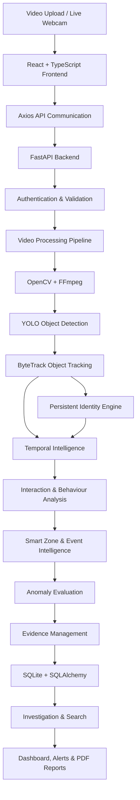

# NEMESIS-X
### Context-Aware AI Video Intelligence, Persistent Object Identity & Anomaly Detection

Transforming Ordinary Surveillance into Intelligent, Explainable Video Intelligence.

## 1. Overview

**NEMESIS-X** is an AI-powered video intelligence and investigation platform that transforms traditional video surveillance into an intelligent, context-aware monitoring system.

Traditional surveillance systems primarily depend on human operators to continuously observe camera feeds and manually identify suspicious activities. They often lack the ability to understand relationships between objects, remember previous observations, recognize repeated appearances, or explain why an event is unusual.

NEMESIS-X addresses these limitations by combining:

- Real-time object detection
- Multi-object tracking
- Persistent entity identity recognition
- Temporal memory and event analysis
- Human-object interaction intelligence
- Behaviour analysis
- Smart geographical zones
- Anomaly and suspicious activity identification
- Evidence-based investigation
- Intelligent video search
- Automated incident reporting

Instead of examining individual video frames independently, NEMESIS-X analyses how people and objects move, interact, and behave over time.

The platform converts visual observations into structured intelligence, helping investigators understand **what happened, when it happened, which entities were involved, and what visual evidence supports the event.**

---

## 2. Problem Statement

Conventional CCTV surveillance systems generate enormous amounts of video data but provide limited intelligent understanding of what happens inside the footage.

Security operators must manually monitor multiple camera feeds, identify unusual behaviour, track individuals, and investigate incidents.

Existing approaches often face the following challenges:

1. **Continuous Manual Monitoring:** Human operators must continuously observe video streams, making it difficult to identify every important event.

2. **Lack of Temporal Understanding:** Individual frame-based detection systems cannot independently understand the complete sequence of activities occurring over time.

3. **Fragmented Object Tracking:** The same person or object may receive different tracking IDs when detection is interrupted or tracking fragments occur.

4. **No Persistent Entity Context:** Conventional systems provide limited capabilities to group repeated appearances of visually similar entities within an investigation.

5. **Limited Interaction Understanding:** Detecting a person and an object separately does not explain whether they interacted, approached, picked up, or abandoned something.

6. **Lack of Contextual Anomaly Detection:** Unusual activities cannot always be identified using object detection alone.

7. **Difficult Investigation Process:** Investigators must manually search lengthy recordings to locate specific events and supporting evidence.

8. **Limited Evidence-Based Reporting:** Generating incident timelines and reports requires considerable manual effort.

### Our Goal

To develop an intelligent video surveillance platform that combines detection, tracking, temporal analysis, interaction intelligence, identity grouping, and evidence-based investigation into one unified system.

---

## 3. Proposed Solution

NEMESIS-X introduces a multi-stage video intelligence pipeline.

The system processes recorded videos and live webcam streams, detects objects, tracks their movement, maintains source-scoped identity information, analyses interactions, identifies unusual events, and stores supporting evidence.

### Core Solution Components

| Component | Solution |
|---|---|
| Object Detection | Identifies people and objects using YOLO |
| Object Tracking | Maintains tracking IDs across video frames using ByteTrack |
| Persistent Identity | Groups likely repeated appearances within a selected source |
| Temporal Analysis | Examines activities and movement across time |
| Interaction Intelligence | Analyses relationships between tracked people and objects |
| Behaviour Intelligence | Evaluates movement patterns and unusual behaviour |
| Smart Zone Intelligence | Identifies entry, exit, restricted-zone and loitering events |
| Anomaly Analysis | Identifies explainable unusual activity patterns |
| Investigation Workspace | Connects analyses, events, tracks and evidence |
| Intelligent Search | Searches stored detections, events and track information |
| Evidence Management | Stores timestamped annotated frames and evidence references |
| Voice Intelligence | Provides event announcements and speech assistance |
| Report Generation | Generates structured PDF investigation reports |

---

## 4. Key Features

### 4.1 AI-Based Object Detection

NEMESIS-X uses the YOLO object detection framework to identify objects appearing in video frames.

It detects supported object categories and generates:

- Object class
- Detection confidence
- Bounding box coordinates
- Frame timestamp
- Detection information

The detection results are passed to the tracking pipeline for further analysis.

### 4.2 Multi-Object Tracking

NEMESIS-X integrates ByteTrack for multi-object tracking.

Each detected object receives a tracking identifier.

For example:

```text
Frame 001: Person → T001
Frame 002: Person → T001
Frame 003: Person → T001
Frame 004: Person → T001
```

The tracker maintains the same ID across consecutive observations while the track remains active.

This helps the system understand object movement instead of treating every detection as a completely new object.

### 4.3 Persistent Identity Recognition

One of the important capabilities of NEMESIS-X is its Unique Entity Intelligence workspace.

A person or object can appear multiple times in a video and may have multiple tracker fragments.

The identity engine attempts to group likely repeated appearances into one anonymous entity.

Example:

```text
Original Tracking Results:

Person → T001
Person → T004
Person → T009

Identity Grouping:

P001
 ├── T001
 ├── T004
 └── T009
```

Similarly, objects are assigned anonymous identities:

```text
O001 → Object identity
O002 → Object identity
```

**How it works:**

- Preserves original ByteTrack IDs.
- Extracts lightweight visual appearance descriptors.
- Compares colour, brightness, edge orientation and shape.
- Uses heuristic similarity thresholds.
- Groups likely matching tracker fragments.
- Supports manual reassignment and separation.
- Displays appearance evidence and related events.

Person and object matching use separate heuristic thresholds and ambiguity margins.

Important: Identity grouping is limited to the selected video analysis or live session. It does not claim cross-video or cross-session identity recognition. It does not use face recognition or a trained person re-identification model.

### 4.4 Temporal Intelligence

NEMESIS-X does not depend only on individual frame predictions.

It analyses observations across time to understand how activities evolve.

The temporal pipeline considers:

- Movement direction changes
- Repeated interactions
- Object movement
- Event sequences
- Duration-based behaviour
- Relationships between observations
- Supporting visual evidence

This allows the platform to identify meaningful sequences rather than simply displaying independent object detections.

### 4.5 Behaviour Intelligence

The Behaviour Intelligence workspace provides movement and event analysis for recorded videos and live webcam sessions.

Capabilities include:

- Movement direction changes
- Walking- and running-like estimates
- Repeated interaction analysis
- Explainable anomaly scores
- Event correlations
- Supporting evidence
- Configurable per-session baseline rules

Movement speeds are normalized image coordinates per second, not physical-world speeds.

Behaviour scores use explainable components and configurable weights. They are not presented as calibrated probabilities.

### 4.6 Smart Zone Intelligence

NEMESIS-X provides configurable polygon-based monitoring zones.

Users can create zones directly on video frames.

Supported zone categories include:

- Restricted zones
- Safe zones
- Monitoring zones
- Entry zones
- Exit zones

Additional configurations include:

- Zone colour
- Confirmation frames
- Event cooldown
- Loiter duration
- Restricted-group size
- Alert preferences

The system evaluates tracked objects against configured polygon boundaries.

It can identify:

- Zone entry
- Zone exit
- Restricted-area presence
- Loitering
- Group-size violations

Zone events are based on tracked observations and configured conditions.

### 4.7 Investigation Workspace

The Investigation Workspace connects completed video analyses and stopped live monitoring sessions.

Investigators can:

- Create investigations
- Link and unlink video analyses
- Link and unlink events
- Link and unlink tracks
- Add private investigation notes
- Review chronological timelines
- View relationship graphs
- Filter by source, severity and event category
- Access supporting evidence
- Manage investigation status

Investigation statuses:

- Open
- Reviewing
- Closed

All investigation records and linked data are scoped to the authenticated user.

### 4.8 Intelligent Video Search

The Intelligent Video Search workspace allows users to search stored video intelligence without manually reviewing the entire recording.

It supports searches involving:

- Person and object categories
- Tracker identifiers
- Interaction-related events
- Pickup events
- Unattended objects
- Zone events
- Anomaly-related events
- Timestamp ranges

Example searches:

```text
Find person T001
Find all people
Find unattended objects
Find interaction events
Find anomalies between 00:30 and 02:00
Find person tracks
```

The search engine uses stored database information and deterministic query parsing. It does not send uploaded video media to an external search service.

### 4.9 Live Monitoring

NEMESIS-X supports live webcam monitoring.

The live monitoring pipeline processes incoming frames and performs detection, tracking, zone evaluation and event analysis.

Features include:

- Live webcam processing
- Object detection
- Tracking IDs
- Annotated frame previews
- Live event monitoring
- Smart zone evaluation
- Session-specific identity information
- Evidence snapshots

Live monitoring state is isolated by session.

Continuous live video recording or reconstruction of a complete live recording is not claimed.

### 4.10 Evidence Management

Every important event should have supporting evidence.

NEMESIS-X maintains evidence references associated with detections, events, investigations and tracking information.

Evidence can include:

- Annotated frames
- Timestamped snapshots
- Detection information
- Track references
- Event details

Original uploaded videos and evidence files are not overwritten by annotation or playback preparation.

### 4.11 Browser-Compatible Video Playback

Some video formats cannot be played directly in browsers.

NEMESIS-X checks video container and codec compatibility.

When required, FFmpeg generates a separate browser-compatible playback copy.

The original uploaded recording remains unchanged.

Evidence-frame navigation remains available even when browser playback or conversion is unsuccessful.

### 4.12 Voice Intelligence

NEMESIS-X includes voice-related functionality for event announcements and speech assistance.

The frontend uses browser speech capabilities, while the backend provides text-to-speech functionality through Edge TTS.

The system supports English and Kannada alert preferences.

### 4.13 Automated PDF Reports

The platform generates structured PDF reports using ReportLab.

Reports help investigators review and document video intelligence findings.

Report information can include:

- Analysis details
- Event summaries
- Timestamps
- Severity information
- Entity and track references
- Supporting evidence

---

## 5. Technology Stack

NEMESIS-X uses a modular architecture with a React frontend, FastAPI backend and computer vision processing pipeline.

### Frontend

| Technology | Purpose |
|---|---|
| React 19 | Component-based user interface |
| TypeScript | Type-safe frontend development |
| Vite | Frontend development and build tool |
| Tailwind CSS 4 | Styling and responsive layouts |
| React Router | Application navigation |
| Axios | Backend API communication |
| Lucide React | Interface icons |
| Motion | UI animations |

### Backend

| Technology | Purpose |
|---|---|
| Python | Core backend programming |
| FastAPI | REST API development |
| Uvicorn | ASGI application server |
| Pydantic Settings | Environment configuration |
| SQLAlchemy | Database ORM |
| SQLite | Persistent structured data |
| PyJWT | Authentication tokens |
| Argon2 | Password hashing |
| Python Multipart | File uploads |

### AI and Computer Vision

| Technology | Purpose |
|---|---|
| Ultralytics YOLO | Object detection |
| ByteTrack | Multi-object tracking |
| OpenCV | Frame processing and image operations |
| LAP | Tracking assignment optimization dependency |
| NumPy / image processing operations | Visual feature and coordinate calculations |
| Custom Temporal Engine | Time-based event and behaviour analysis |
| Custom Identity Engine | Appearance-based entity grouping |
| Polygon Geometry Logic | Smart zone evaluation |

### Media and Reporting

| Technology | Purpose |
|---|---|
| FFmpeg | Video conversion and compatibility |
| imageio-ffmpeg | FFmpeg distribution for Python |
| ReportLab | PDF report generation |
| Edge TTS | Backend text-to-speech |
| Web Speech API | Browser speech capabilities |

### Development and Testing

| Technology | Purpose |
|---|---|
| Git | Version control |
| GitHub | Source code management |
| Pytest | Backend testing |
| TypeScript Compiler | Type checking |
| Oxlint | Frontend linting |
| Vite | Production frontend builds |

---

## 6. AI Models and Intelligence Approach

### Object Detection Model

NEMESIS-X uses the Ultralytics YOLO framework.

The configured default detection model is:

```text
yolov8n.pt
```

The model can be changed through the backend environment configuration.

YOLO is responsible for identifying supported object classes and producing bounding-box detections.

### Tracking Algorithm

**ByteTrack** is used for multi-object tracking.

It associates detections across frames and maintains tracking IDs.

### Persistent Identity Engine

A custom appearance-based identity grouping engine compares visual descriptors.

It uses:

- HSV colour information
- Brightness
- Edge orientation
- Shape descriptors
- Similarity thresholds
- Ambiguity margins

This is a lightweight CPU-friendly approach, not a trained facial recognition or deep re-identification model.

### Behaviour and Anomaly Intelligence

NEMESIS-X uses custom explainable event and behaviour analysis.

It evaluates tracked movement, interaction information, zone transitions, event sequences and configured baselines.

It does not claim that an external LLM or a trained Isolation Forest model is responsible for the current anomaly detection pipeline.

---

## 7. System Architecture

NEMESIS-X follows a modular, layered architecture.

### High-Level Architecture



### Architecture Explanation

**1. Input Layer**

The application receives recorded video files or live webcam frames.

**2. Presentation Layer**

React and TypeScript provide the user interface for uploading videos, monitoring sessions, reviewing events and managing investigations.

**3. API Layer**

FastAPI handles authentication, requests, file uploads and communication between frontend and backend services.

**4. Video Processing Layer**

OpenCV processes video frames, while FFmpeg supports media compatibility and conversion.

**5. Detection Layer**

YOLO identifies people and supported objects in individual frames.

**6. Tracking Layer**

ByteTrack associates detected objects across frames and generates tracking identifiers.

**7. Identity Layer**

The custom identity engine compares visual appearance descriptors and groups likely repeated tracker fragments within the selected source.

**8. Intelligence Layer**

Temporal, interaction, behaviour and smart-zone engines evaluate observations and generate structured events.

**9. Evidence Layer**

Important events are associated with timestamped visual evidence and source-specific track information.

**10. Persistence Layer**

SQLite and SQLAlchemy maintain application records, tracking information, events, investigations and related metadata.

**11. Output Layer**

The frontend displays intelligence results, monitoring information, investigation timelines, evidence and generated reports.

---

## 8. Data Flow

The following sequence describes how NEMESIS-X processes a recorded video.

```text
User Uploads Video
        |
        v
FastAPI Receives Video
        |
        v
Video Stored in Local Storage
        |
        v
OpenCV Extracts Frames
        |
        v
YOLO Detects Objects
        |
        v
ByteTrack Assigns Tracking IDs
        |
        v
Persistent Identity Engine
        |
        v
Temporal Memory & Observation Analysis
        |
        v
Interaction and Behaviour Intelligence
        |
        v
Smart Zone and Event Evaluation
        |
        v
Anomaly Identification
        |
        v
Evidence Extraction
        |
        v
SQLite Database Persistence
        |
        v
Investigation and Intelligent Search
        |
        v
Dashboard, Alerts and PDF Reports
```

---

## 9. Project Folder Structure

The following structure represents the repository's main modules and their responsibilities.

```text
NEMESIS-X/
│
├── backend/
│   │
│   ├── app/
│   │   ├── api/
│   │   │   ├── analysis.py
│   │   │   ├── auth.py
│   │   │   ├── behavior.py
│   │   │   ├── events.py
│   │   │   ├── evidence.py
│   │   │   ├── health.py
│   │   │   ├── identities.py
│   │   │   ├── investigations.py
│   │   │   ├── live.py
│   │   │   ├── monitoring.py
│   │   │   ├── reports.py
│   │   │   ├── search.py
│   │   │   ├── settings.py
│   │   │   ├── tts.py
│   │   │   ├── videos.py
│   │   │   └── zones.py
│   │   │
│   │   ├── core/
│   │   │   └── security.py
│   │   │
│   │   ├── models/
│   │   │   └── Database models
│   │   │
│   │   ├── schemas/
│   │   │   └── Request and response schemas
│   │   │
│   │   ├── services/
│   │   │   └── Business logic and intelligence services
│   │   │
│   │   ├── workers/
│   │   │   └── Video processing workers
│   │   │
│   │   ├── config.py
│   │   ├── database.py
│   │   └── main.py
│   │
│   ├── tests/
│   │   ├── test_behavior_engine.py
│   │   ├── test_identity_api.py
│   │   ├── test_identity_engine.py
│   │   ├── test_intelligence_search.py
│   │   ├── test_interaction_intelligence.py
│   │   ├── test_investigations.py
│   │   ├── test_live_monitoring.py
│   │   ├── test_monitoring.py
│   │   ├── test_settings.py
│   │   ├── test_track_explorer.py
│   │   ├── test_tts.py
│   │   ├── test_video_playback.py
│   │   ├── test_zone_api.py
│   │   └── test_zone_engine.py
│   │
│   ├── requirements.txt
│   └── .env.example
│
├── frontend/
│   │
│   ├── public/
│   │   ├── favicon.svg
│   │   ├── icons.svg
│   │   └── videos/
│   │
│   ├── src/
│   │   ├── assets/
│   │   ├── components/
│   │   ├── context/
│   │   ├── data/
│   │   ├── pages/
│   │   ├── services/
│   │   ├── App.tsx
│   │   ├── App.css
│   │   ├── index.css
│   │   └── main.tsx
│   │
│   ├── tests/
│   │   └── voiceIntelligence.test.ts
│   │
│   ├── index.html
│   ├── package.json
│   ├── package-lock.json
│   ├── tsconfig.json
│   └── vite configuration
│
├── storage/
│   └── live/
│
├── .env.example
├── .gitignore
├── LICENSE
└── README.md
```

### Important Directory Responsibilities

| Directory | Responsibility |
|---|---|
| `backend/app/api/` | REST API endpoints |
| `backend/app/core/` | Authentication and security |
| `backend/app/models/` | SQLAlchemy database models |
| `backend/app/schemas/` | Data validation schemas |
| `backend/app/services/` | Processing and intelligence logic |
| `backend/app/workers/` | Processing worker modules |
| `backend/tests/` | Backend unit and API tests |
| `frontend/src/components/` | Reusable interface components |
| `frontend/src/pages/` | Application pages |
| `frontend/src/services/` | API integration and frontend services |
| `frontend/src/context/` | Shared application state |
| `frontend/tests/` | Frontend tests |
| `storage/` | Local runtime storage |

---

## 10. Database Architecture

NEMESIS-X uses SQLite with SQLAlchemy ORM.

The database stores structured application information rather than relying on video files as the database.

Important information includes:

- User accounts
- Uploaded video metadata
- Analysis records
- Detection and tracking information
- Event records
- Behaviour analysis
- Identity information
- Smart zone configurations
- Investigation records
- Investigation notes
- Evidence references

Investigation-related tables include:

```text
investigations
investigation_sources
investigation_events
investigation_tracks
investigation_notes
```

Identity and investigation records use the existing SQLAlchemy startup table-creation mechanism.

The current project does not use Alembic migrations.

Uploaded videos and generated media remain separate from structured database records.

---

## 11. API Architecture

The backend exposes REST API endpoints under:

```text
/api/v1
```

Major API modules include:

| API Module | Responsibility |
|---|---|
| `/auth` | Authentication |
| `/videos` | Video uploads and playback |
| `/analysis` | Video analysis |
| `/live` | Live monitoring |
| `/monitoring` | Monitoring history |
| `/events` | Event management |
| `/evidence` | Evidence retrieval |
| `/behavior` | Behaviour intelligence |
| `/identities` | Persistent identity management |
| `/investigations` | Investigation management |
| `/search` | Intelligent video search |
| `/zones` | Smart zone management |
| `/reports` | PDF report generation |
| `/settings` | Application settings |
| `/tts` | Text-to-speech |

Interactive API documentation is available through FastAPI Swagger UI.

```text
http://localhost:8000/docs
```

Health endpoint:

```text
/api/v1/health
```

---

## 12. Installation and Setup

### Prerequisites

Install the following:

- Python 3.10 or compatible supported Python version
- Node.js and npm
- Git
- A webcam for live monitoring
- FFmpeg-compatible media processing dependencies

### Step 1: Clone the Repository

```bash
git clone https://github.com/Chandanaa-003/NEMESIS-X.git

cd NEMESIS-X
```

### Step 2: Backend Setup

Navigate to the backend directory:

```bash
cd backend
```

Create a virtual environment:

```bash
python -m venv .venv
```

Activate it on Windows:

```powershell
.venv\Scripts\activate
```

Install dependencies:

```bash
pip install -r requirements.txt
```

Start the backend:

```bash
python -m uvicorn app.main:app --reload
```

Backend:

```text
http://localhost:8000
```

API documentation:

```text
http://localhost:8000/docs
```

### Step 3: Frontend Setup

Open another terminal.

Navigate to the frontend directory:

```bash
cd frontend
```

Install dependencies:

```bash
npm install
```

Start the development server:

```bash
npm run dev
```

Open the local URL displayed by Vite.

### Step 4: Environment Configuration

Use the root `.env.example` and backend `.env.example` as configuration references.

Configure the required values for your local environment.

Important configuration parameters include:

```env
APP_NAME=NEMESIS-X
APP_ENV=development
DEBUG=true

BACKEND_HOST=0.0.0.0
BACKEND_PORT=8000

DETECTION_MODEL=yolov8n.pt
CONFIDENCE_THRESHOLD=0.5
FRAME_SAMPLE_FPS=2
TEMPORAL_WINDOW_SECONDS=10

ALERT_LANGUAGES=en,kn
DEFAULT_ALERT_LANGUAGE=en

STORAGE_ROOT=./storage
```

Keep actual secrets and local environment files out of GitHub.

---

## 13. Testing and Validation

NEMESIS-X includes backend tests for important intelligence modules and API functionality.

### Run Backend Tests

From the `backend/` directory:

```bash
python -m pytest tests -q
```

### Build Frontend

From the `frontend/` directory:

```bash
npm run build
```

### Run Frontend Linting

```bash
npm run lint
```

The test suite includes coverage for:

- Behaviour intelligence
- Identity engine
- Identity API
- Intelligent search
- Interaction intelligence
- Investigation management
- Live monitoring
- Video playback
- Smart zone engine
- Smart zone API
- Voice intelligence

---

## 14. Security and Privacy

NEMESIS-X includes authentication and ownership checks for protected resources.

Security-related implementation includes:

- JWT-based authentication
- Argon2 password hashing
- Authenticated API access
- User-scoped investigations
- User-scoped video and session operations
- Protected evidence endpoints
- Local video processing
- Database-backed search

The identity engine does not perform facial recognition.

The intelligent search implementation operates on stored metadata and does not send uploaded video media to an external search service.

---

## 15. What Makes NEMESIS-X Different?

| Traditional CCTV | NEMESIS-X |
|---|---|
| Primarily manual monitoring | Intelligent video analysis |
| Individual frame detection | Temporal event analysis |
| Basic object tracking | Tracking and identity grouping |
| Limited interaction context | Person-object interaction intelligence |
| Manual zone monitoring | Configurable smart zones |
| Manual investigation | Structured investigation workspace |
| Manual video searching | Intelligent metadata-based search |
| Manual evidence collection | Timestamped evidence management |
| Manual reporting | Automated PDF reports |

### Our Key Innovation

The main strength of NEMESIS-X is the integration of multiple intelligence components into one investigation-oriented platform.

Instead of treating object detection, tracking, anomaly analysis and investigation as independent tasks, NEMESIS-X connects their outputs through source-specific temporal and identity context.

This makes it possible to move from:

**Detection → Tracking → Identity Grouping → Behaviour Understanding → Event Analysis → Evidence → Investigation.**

---

## 16. Current Limitations

NEMESIS-X is designed with explainability and transparent system behaviour in mind.

The following limitations are important:

- Identity grouping is limited to a selected video analysis or live session.
- Appearance similarity does not prove that two observations represent the same real-world individual or object.
- No facial recognition is implemented.
- No trained deep re-identification model is claimed.
- Movement speed is measured in normalized image coordinates, not physical units.
- Behaviour baselines are descriptive rules, not learned statistical models.
- Live monitoring does not reconstruct a continuous archived recording.
- Anomaly scores are explainable component-based scores, not calibrated probabilities.
- Intelligent search operates on stored records and supported deterministic filters.

---

## 17. Future Scope

Potential improvements include:

- Advanced vision-language model integration.
- Stronger cross-camera entity association.
- Improved object re-identification.
- More sophisticated temporal reasoning.
- Multi-camera intelligence.
- Advanced anomaly detection models.
- Scalable distributed video processing.
- Real-time notification integrations.
- More detailed investigation analytics.
- Enhanced multilingual voice interaction.

These are future directions, not claims about currently implemented functionality.

---

## 18. Team

**Project:** NEMESIS-X

**Team:** ByteForce

**Hackathon:** Flip the Switch Hackathon

---

## 19. Repository

GitHub:

[https://github.com/Chandanaa-003/NEMESIS-X](https://github.com/Chandanaa-003/NEMESIS-X)

---

## 20. License

This project is distributed under the license available in the repository's `LICENSE` file.

